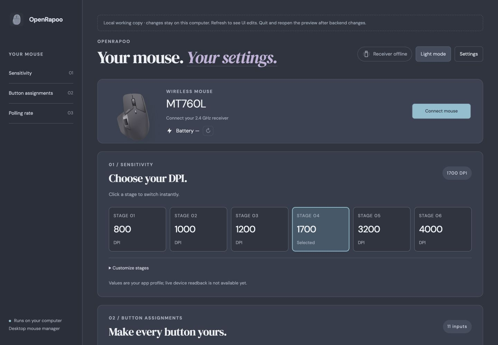
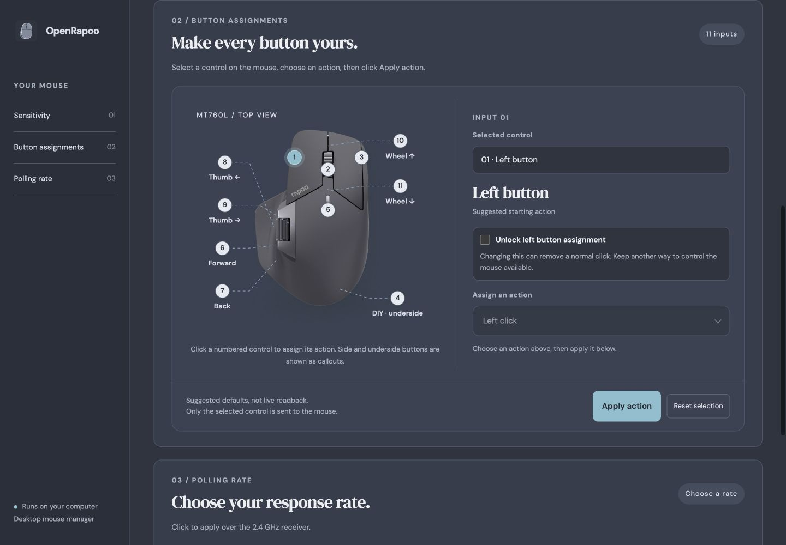
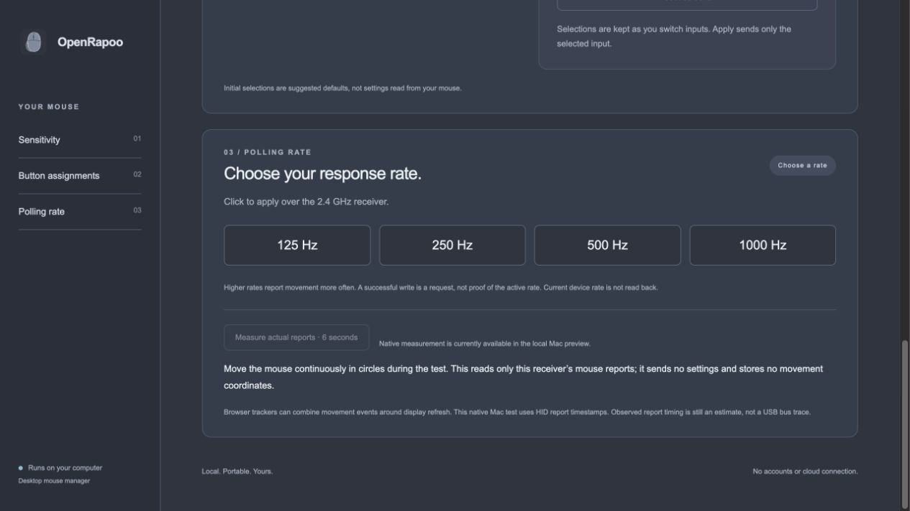

# OpenRapoo

A small desktop app for the **Rapoo MT760L**, connected through its **2.4 GHz USB receiver**. Change DPI, assign buttons, choose a polling rate and check the battery reported by the mouse.

The app uses a native window on macOS and Windows. Normal use needs no terminal, external browser, npm installation or separately installed Node runtime.

[Download the latest preview](https://github.com/diamachi/rapoo-mt760L/releases) · [Build and release guide](docs/PUBLISHING.md) · [Development guide](docs/DEVELOPMENT.md)

> Unofficial project, not affiliated with Rapoo. Releases are currently unsigned previews. OpenRapoo runs locally; no cloud account is needed.

## A look at the app

### Mouse status, battery and sensitivity

The device card shows connection status and the mouse-reported battery percentage. Click a DPI stage to apply it, or expand **Customize stages** to edit the profile.



### Visual button assignments

Select a numbered control on the mouse, choose an action and click **Apply action**. The 11 inputs include the main buttons, side buttons, DIY/DPI buttons and both wheel directions. Left and Right click are locked by default. Tick the unlock checkbox before choosing a different action; the unlock resets after applying or switching controls. Restoring the standard click remains available without unlocking. The wide action menu groups actions by type and supports search and keyboard navigation. The screenshot shows the searchable action menu in the current dark theme.



### Polling rate and native measurement

Choose **125, 250, 500 or 1000 Hz**. On Mac, use the six-second native measurement while moving continuously to check observed report timing. The screenshot shows the available controls in an isolated preview with hardware access disabled.



Screenshots are actual local app captures from a hardware-isolated UI preview. DPI values are example profile values; battery remains unavailable until connected.

## What it does

| Feature | Behavior |
| --- | --- |
| DPI profile | Six editable stages; one-click switching. Applying sends the complete DPI profile. |
| Button assignments | Mouse actions, keyboard shortcuts, media controls and other supported vendor actions, selected through the mouse map. |
| Polling selection | Sends the captured/DLL-backed 125/250/500/1000 Hz configuration over the receiver. |
| Report-rate measurement | Mac-only, six-second read of mouse-report timestamps; retains no movement coordinates or keyboard input. |
| Battery | Reads the reported percentage on connection, every visible minute, or manual refresh. Wake the mouse if it times out. |
| Appearance | Light mode and a Nord-style dark palette, with a matching mouse app icon. |
| Developer tools | Settings → Developer mode, or Cmd/Ctrl+Shift+D: packet explorer, command previews and activity log. |
| Safe command preview | **Preview writes only** records the command without applying it. Leaving Developer mode turns this option off. |

DPI/button selections are an app profile and suggested defaults, **not live device readback**. A successful write means the report was sent; it does not prove the effect. Battery is read from the mouse. Observed report timing is measured separately and is not a USB bus trace. Applying a setting after Disconnect reconnects the receiver automatically.

## Install

- **Mac Apple silicon, macOS 14+:** open the release DMG, drag **OpenRapoo** into Applications, then open it. Allow Input Monitoring if macOS requires it for receiver access, then quit and reopen.
- **Windows x64:** run the release `…-windows-x64-setup.exe`, then open **OpenRapoo** from Start. Setup provides uninstall support and adds Microsoft WebView2 only if missing; that prerequisite download needs internet.

Closing the window stops the local service. The app works locally without an account or cloud service. Use the USB receiver: Bluetooth, Intel Mac, Linux desktop packaging and other mouse models are not verified.

The original Mac/Windows packages were hardware-tested; native Mac polling and battery reporting were checked separately. CI checks source, both native windows, service shutdown and Windows install/uninstall. Windows battery behavior and the taskbar icon still need physical/visual testing.

## Build from source with portable tools

The source ZIP and Git repository **do not include runtimes**. This workspace may already have them under `_toolchain/`. There are no npm dependencies and no frontend compilation step. Only the platform build tools listed below are required; the original vendor executables are research inputs, not build dependencies.

### Required local environment

| Target | Required tools |
| --- | --- |
| Source tests / browser preview | Portable **Node 26.4.0**, a matching OS/architecture, and a browser. Native receiver control in the browser preview is supported on Mac; Windows browser fallback uses Chrome/Edge WebHID. |
| Mac app and DMG | Apple silicon Mac, macOS 14+, portable Node, **already available Apple Command Line Tools** (`xcrun swiftc`), and macOS system tools `zip`/`hdiutil`. |
| Windows app and installer | Windows x64 builder (CI uses Server 2025), portable Node, existing **.NET Framework x64 compiler**, PowerShell, and **Inno Setup 6**. WebView2 SDK files are downloaded to the project cache. |
| Icon regeneration only | Mac with existing Apple tools: AppKit/Swift, `sips` and `iconutil`. Generated ICNS/ICO assets are already supplied. |

Portable Node replaces a global Node installation. Apple/.NET compilers and Inno Setup are platform build prerequisites; they are not bundled portable tools. If they are unavailable, use GitHub Actions instead of installing anything on this Mac.

### Prepare the portable runtime

Download Node **26.4.0** from the [official release directory](https://nodejs.org/dist/v26.4.0/) and verify its archive against `SHASUMS256.txt` before extraction. Keep only the matching executable and upstream license:

```text
_toolchain/
  portable-node-macos-arm64/
    node
    LICENSE
  portable-node-windows-x64/
    node.exe
    LICENSE
```

Use `node-v26.4.0-darwin-arm64.tar.gz` for this Mac or `node-v26.4.0-win-x64.zip` for Windows. The Mac executable comes from `bin/node` inside the archive. Preserve executable permission on Mac.

Once Node is available, `scripts/fetch-runtime.mjs` can fetch and verify another target's runtime into the labeled folder. It never installs globally. Network access is also needed for the Windows WebView2 SDK/bootstrapper during a fresh build; running the Mac app requires no download.

### Mac: test, preview and package

Run from the project root:

```sh
# Tests use synthetic/mocked reports; they do not change the mouse.
sh test-macos.command

# Build a small local preview that reads the working source directly.
_toolchain/portable-node-macos-arm64/node scripts/build-preview.mjs
open "preview/OpenRapoo Preview.app"

# Optional distribution outputs.
_toolchain/portable-node-macos-arm64/node scripts/package-release.mjs source
_toolchain/portable-node-macos-arm64/node scripts/package-release.mjs macos-arm64
```

In the preview, **Cmd+R** reloads UI edits. Quit/reopen after backend changes; rebuild after native Swift changes. The preview is tied to this folder and should not be distributed. [Detailed local testing instructions](docs/LOCAL-TESTING.md).

### Windows: test and package

Run from the project root in PowerShell:

```powershell
& .\_toolchain\portable-node-windows-x64\node.exe --test app/test/*.test.mjs
& .\_toolchain\portable-node-windows-x64\node.exe scripts/package-release.mjs windows-x64
```

Build Windows on Windows; the Mac does not cross-compile the Windows executable. If Inno Setup is outside its standard location, adjust the compiler path in `scripts/package-release.mjs` before building. The SDK cache stays in `_toolchain/`; output stays in `dist/`.

The builder refuses an existing staging directory. For a new release, update `app/package.json` and the matching Mac Info.plist version. For repeated local builds of the same version, remove only that target's generated staging folder and archive first. Each package includes a file manifest and SHA-256 sidecar.

### GitHub Actions

**Actions → Build desktop apps → Run workflow** builds on Mac and Windows. Leave `release_tag` empty for artifacts only. After testing and approving a release, supply a matching tag such as `v0.4.0-preview.1`, or deliberately push a matching `v*` tag. Publishing waits for both platform checks and checksum verification. Ordinary pushes to `main` do not publish or trigger this workflow. Existing releases are not overwritten.

## Project layout

```text
app/               Shared interface, report encoders, native access and tests
packaging/         Native app windows, installer definitions and icon assets
scripts/           Portable launch/build utilities and optional research tools
docs/              Build/development guides and screenshots
research/          Protocol evidence and validation limits
_toolchain/        Local runtimes and regenerable build cache (ignored)
preview/           Generated source-linked Mac preview (ignored)
dist/              Generated distribution outputs (ignored)
rapoo-re/          Original vendor inputs/capture (local only, ignored)
personal/          Private handbook/notes (local only, never packaged)
```

See the [file guide](docs/FILES.md) for individual files, [polling evidence](research/POLLING-RATE.md) and [battery evidence](research/BATTERY.md) for protocol details. Research scripts are optional and kept because they make the reverse engineering reproducible; they are not shipped in desktop runtime packages.

## Size and licensing

The UI uses plain HTML/CSS/JavaScript, the system WebKit/WebView2 engine and a bundled portable Node runtime, rather than a bundled Chromium/Electron runtime. Node is the largest required component; removing it would require replacing the backend and Mac FFI transport. Desktop packages exclude tests, native source files and research scripts. The hidden packet explorer renders only when Developer mode is opened.

Original source and mouse icon artwork are MIT licensed. The product photo, Node and Microsoft components have separate attribution/licensing; see [third-party notices](THIRD_PARTY_NOTICES.md).
